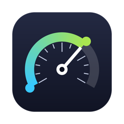
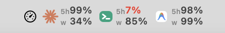
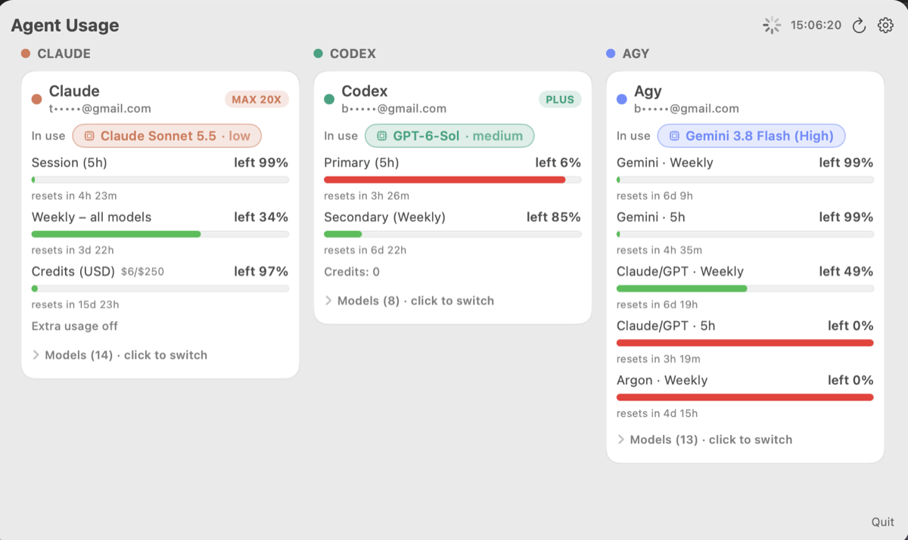
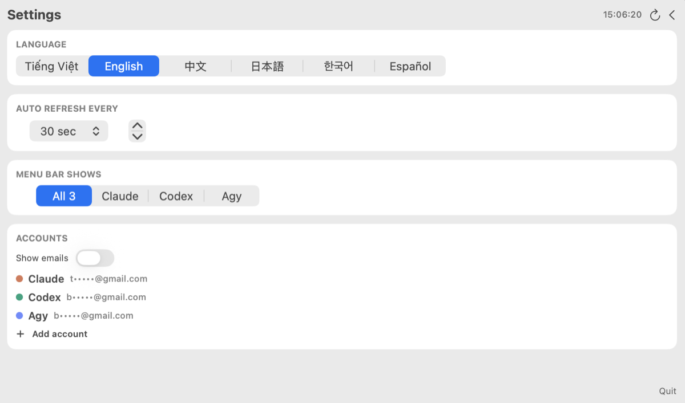

<p align="center"></p>
<h1 align="center">Agent Usage</h1>
<p align="center">See how much quota is left on <b>Claude Code</b>, <b>Codex</b> and <b>Antigravity</b> without leaving your menu bar.</p>

<p align="center"><a href="https://buymeacoffee.com/bvnkame"></a></p>

<p align="center"></p>

Each agent shows its logo with two small rows: the **5-hour** quota on top and the **weekly** quota below, as the percentage still left. Numbers turn orange under 30% and red under 10%.

## What you get

- One glance at all three CLIs; no more opening each one and typing `/usage`.
- A popup with every limit, its reset countdown, the model in use, and a model switcher.
- Several accounts per CLI (each with its own login folder).
- Emails hidden by default (click one to reveal, or turn on **Show emails**).
- Six languages: Tiếng Việt, English, 中文, 日本語, 한국어, Español.
- Runs on macOS, Windows and Linux.

<p align="center"></p>
<p align="center"></p>

## Install

Download the build for your system from the [Releases](../../releases) page, or build it yourself (below).

| System | File |
|---|---|
| macOS | `.dmg` (Electron) or the native app built with `./build.sh mac` |
| Windows | `Setup .exe` or portable `.exe` |
| Linux | `.AppImage` or `.deb` |

You only need to be logged in to the CLIs you want to watch (`claude`, `codex`, `agy`). The app reads the sign-in they already saved.

## Build

```sh
./build.sh mac       # native macOS app (Swift), needs Xcode or Command Line Tools
./build.sh mac-app   # macOS dmg + zip (Electron)
./build.sh win       # Windows installer + portable exe
./build.sh linux     # Linux AppImage + deb
```

Electron builds need Node 20+. Build Windows on Windows and Linux on Linux when you can; the GitHub Action in `.github/workflows/release.yml` builds all three on native runners when you push a `v*` tag.

Run from source: `cd desktop && npm install && npm start`.

## How it reads quota

Only the vendors' own endpoints are called, with the credentials your CLIs already stored on your machine. Nothing goes anywhere else.

| Agent | Source |
|---|---|
| Claude | Anthropic usage API; token from the macOS Keychain (`Claude Code-credentials`) or `~/.claude/.credentials.json` |
| Codex | ChatGPT usage API; token from `~/.codex/auth.json` |
| Agy | `agy -p /usage`, which prints the quota table without calling a model |

Agy quota is split by model group (Gemini, Claude/GPT, Argon). The tray number uses the group of the model you currently have selected.

## Project layout

```
mac/       native macOS menu-bar app (Swift / AppKit)
desktop/   cross-platform tray app (Electron): src/probes.js reads quota, src/renderer/ is the UI
docs/      screenshots and the project page (docs/index.html)
build.sh   one entry point for every build
```

## Support

If this saved you from hitting a limit mid-task, you can buy me a coffee.

[](https://buymeacoffee.com/bvnkame)

Contact: bvnbase@gmail.com. MIT license, see `LICENSE`.

`mac/icon/agy.png` is the Antigravity logo, a trademark of Google, used only to identify that CLI.
